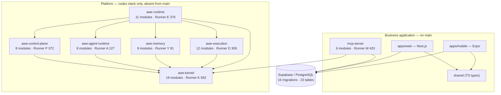
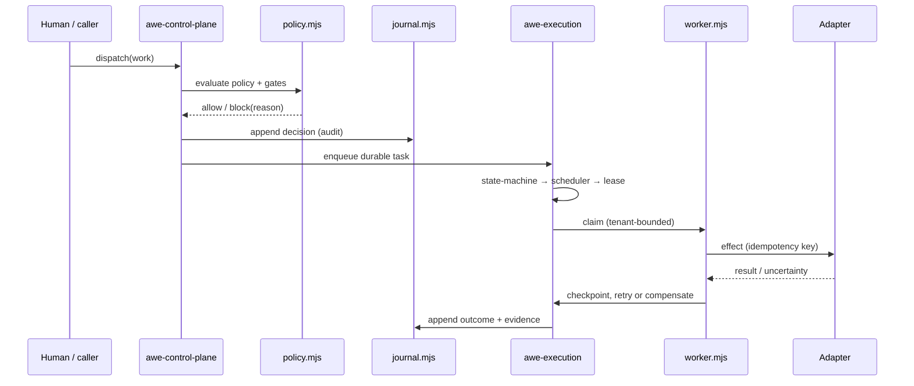
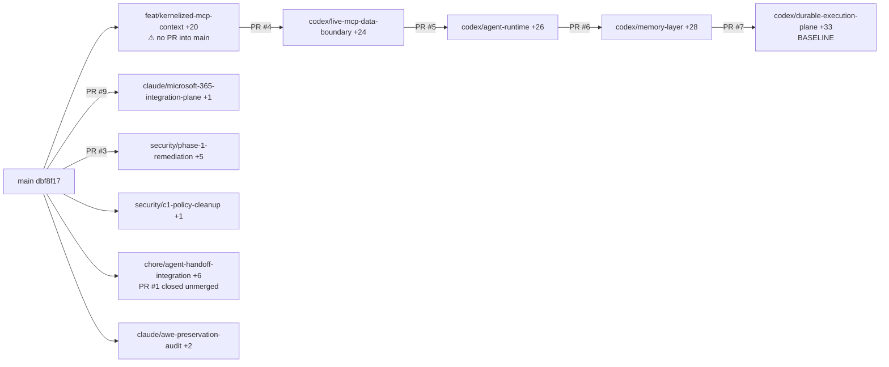

# AWE System Map

**Last verified:** 2026-08-01 at `codex/durable-execution-plane` @ `55c0ba5`
**Derived from:** package sources, import graph, migrations, and passing runners — not from prose.

---

## 1. Package map

**Read it as:** `awe-kernel` is the hub — 26 of the 36 cross-package source imports target it.
`awe-runtime` is the composition root: it holds `agent-service`, `control-plane-service`,
`execution-service`, `memory-service`, plus `clock`, `file-sinks`, `journal-store`, `result-store`.
That is where the planes are wired into services.

**Important:** no package declares another in its `dependencies`. Imports are **relative paths**
(`from '../../awe-kernel/src/...'`). That is why nothing breaks without a workspace link step — and
also why the boundaries are convention, not enforced by the package manager.

## 2. Control flow

Backed by `packages/awe-execution/src/{state-machine,scheduler,worker,effects,retry,recovery,replay}.mjs`
and the seven operator guides in `docs/guides/EXECUTION_*.md`. Runner D asserts each stage,
including "effects — idempotency, uncertainty and compensation are explicit" and "worker retry and
dead letter — bounded attempts are durable".

## 3. Side-effect boundaries

| Boundary | Where enforced | Proof |
|---|---|---|
| Core must not touch provider/network/ambient runtime | `packages/awe-execution` + `awe-kernel` | Runner D: *"layering and source purity — core has no provider, network or ambient runtime"* |
| Service layer must not reach the database directly | `packages/mcp-server` | Runner M lint: `createClient\|supabase\|from\(` forbidden in the service layer |
| The platform service decides no authorization | ADR-0002 | Runner M: *"platform service decides no authorization (ADR-0002)"* |
| Effects carry an idempotency key | `packages/awe-execution/src/effects.mjs` | Runner D + `docs/guides/EXECUTION_IDEMPOTENCY.md` |
| Tenant boundary on every worker claim | `packages/awe-execution/src/worker.mjs`, `packages/mcp-server/src/tenant.mjs` | Runner D *"worker lifecycle, tenant boundary…"*; Runner M |

## 4. Policy and approval enforcement points

| Point | Artifact |
|---|---|
| Control-plane gate before dispatch | `packages/awe-control-plane/src/policy.mjs`, `packages/awe-kernel/src/gates.mjs` |
| Approval matrix + outbound gate | `supabase/migrations/0015_approval_matrix_outbound.sql` (727 lines), Runner 4 (327) |
| Approval evidence schema | `supabase/migrations/0014_approval_evidence.sql` (273 lines), `scripts/lib/validate-migration-0014.mjs` |
| Approval queue (human gate surface) | `apps/web/src/lib/approval-queue.ts`, Runner 5 (349), ADR-0006 |
| Blocked-reason vocabulary | `packages/awe-kernel/src/reasons.mjs`, `scripts/lib/awe-reasons.mjs` — Runner E asserts 11/11 outbound and 2/2 classify reason coverage |
| Kill switch | `agent_harness_settings` per ADR-0007 |

## 5. Database ownership

| Domain | Tables | Owning migration |
|---|---|---|
| Tenancy & identity | `orgs`, `users`, `org_settings` | 0001, 0002 |
| Field operations | `job_sites`, `crews`, `crew_members`, `shifts`, `service_areas`, `cost_codes` | 0001, 0003, 0007 |
| Time & payroll | `time_entries`, `time_entry_audits`, `timecard_corrections`, `pay_periods`, `payroll_exports` | 0007, 0010 |
| Intake | `work_requests`, `email_messages`, `leads` | 0008, **0011 (319 lines)** |
| Completion | `completion_reports`, `integration_events` | 0009 |
| Approval & outbound | `approval_drafts`, `approval_outcomes`, `outbound_messages`, `message_policies`, `category_authority` | 0014, **0015 (727 lines)** |

RLS is established in `0002_rls.sql` and revised by `0004_admin_policies.sql`,
`0012_drop_orphan_schema.sql`, `0016_drop_undeclared_client_policies.sql`.

## 6. External adapters

| Adapter | State |
|---|---|
| Supabase / PostgreSQL | present — `packages/mcp-server/src/data-port.mjs`, `scripts/lib/db.mjs` |
| MCP (Model Context Protocol) | present — `packages/mcp-server`, `@modelcontextprotocol/sdk` |
| Model providers | abstracted — `packages/awe-agent-runtime/src/model.mjs`, `scripts/lib/model-adapters.mjs` |
| Microsoft Graph | **on the M365 branch only**, offline via `fake-graph.ts` |
| **n8n** | **no adapter exists.** 61 doc references, zero code, zero exports |
| Local filesystem sink | present — `packages/awe-runtime/src/file-sinks.mjs`, `packages/awe-kernel/src/sinks.mjs` |

## 7. Branch relationships

**The structural risk:** `feat/kernelized-mcp-context` is the root of the 33-commit tower and has
**no pull request into `main`**. Nothing is lost — it is pushed — but the stack has no integration
path until that PR exists.

## 8. Known missing integrations

n8n adapter · Orchestration/Responsibility plane · Objective plane · live Microsoft Graph proof ·
applied-migration verification · isolated database replay (blocked on Docker).
