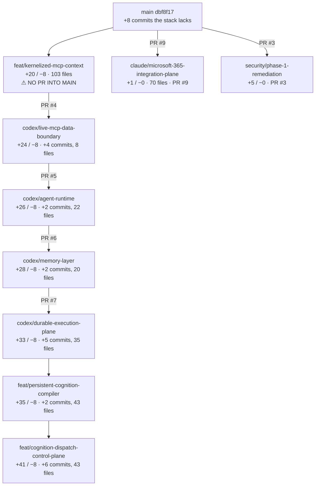

# AWE Branch Integration Graph

**Date:** 2026-08-02 · **Analysed at:** `feat/cognition-dispatch-control-plane` @ `a3961c0`
**Method:** local Git only — `rev-list`, `merge-base`, `diff --name-only`, and
`git merge-tree --write-tree` (a dry-run merge that writes no ref and touches no working tree).
PR relationships read through the already-authenticated `gh`. **No branch was merged, rebased,
cherry-picked or pushed.**

---

## 1. The headline finding

> **The stack is not stranded by a technical obstacle. Every branch in the chain merges into `main`
> with exactly one conflict, in one documentation file: `docs/planning/AGENT_HANDOFF.md` (add/add).**

That was measured, not assumed:

| Branch | Dry-run merge into `main` | Conflicts |
|---|---|---|
| `feat/kernelized-mcp-context` | succeeds | 1 — `docs/planning/AGENT_HANDOFF.md` |
| `codex/live-mcp-data-boundary` | succeeds | 1 — same file |
| `codex/agent-runtime` | succeeds | 1 — same file |
| `codex/memory-layer` | succeeds | 1 — same file |
| `codex/durable-execution-plane` | succeeds | 1 — same file |
| `feat/persistent-cognition-compiler` | succeeds | 1 — same file |
| `feat/cognition-dispatch-control-plane` | succeeds | 1 — same file |
| `claude/microsoft-365-integration-plane-fcsm1e` | succeeds | **0** |
| `security/phase-1-remediation` | succeeds | **0** |

The single conflict exists because `main` advanced by 8 commits (PR #2, the agent-handoff workflow)
that the stack never took, and those 8 commits touch only four files:

```
.github/workflows/agent-handoff.yml
AGENTS.md
docs/planning/AGENT_HANDOFF.md
scripts/validate-agent-handoff.sh
```

Both sides then rewrote `AGENT_HANDOFF.md` independently. That is the whole of the "stranded stack"
problem at the Git level.

**What is genuinely missing is a pull request, not a merge path.** `feat/kernelized-mcp-context` —
the root of the tower — has no PR into `main`, so PRs #4–#7 form a chain that terminates nowhere.

## 2. Branch graph, measured



Ancestry verified with `git merge-base --is-ancestor`: every branch in the chain is a true ancestor
of the one below it. This is a linear stack, not a set of parallel forks.

## 3. Commit accounting

| Link | Commits added | Files changed vs parent |
|---|---|---|
| `main` → `feat/kernelized-mcp-context` | **20** | 103 |
| → `codex/live-mcp-data-boundary` | 4 | 8 |
| → `codex/agent-runtime` | 2 | 22 |
| → `codex/memory-layer` | 2 | 20 |
| → `codex/durable-execution-plane` | 5 | 35 |
| → `feat/persistent-cognition-compiler` | 2 | 43 |
| → `feat/cognition-dispatch-control-plane` | 6 | 43 |
| **Total local work not on `main`** | **41 commits** | **237 files** |

No duplicated or rebased commits were found: each branch's tip is reachable from the next, and no
commit subject appears twice across the chain.

## 4. Dependency reality

Each link genuinely depends on its parent — this is not a stack by convention:

- `codex/agent-runtime` adds `packages/awe-agent-runtime`, which imports `awe-kernel` (introduced on
  `feat/kernelized-mcp-context`) by relative path.
- `codex/memory-layer` adds `packages/awe-memory`, importing the same kernel.
- `codex/durable-execution-plane` adds `packages/awe-execution` **and** the suite registry
  (`packages/awe-kernel/src/registry.mjs`) that `scripts/regression.sh` now resolves through.
- `feat/persistent-cognition-compiler` and `feat/cognition-dispatch-control-plane` import
  `packages/awe-kernel/src/canonical.mjs` for stable digests.

**Consequence:** the capabilities cannot be landed in an arbitrary order. Anything landed before
`feat/kernelized-mcp-context` would reference a package that does not exist.

## 5. Should the cognition/dispatch work land inside this stack?

**Recommendation: no — land it as a separate PR after the platform stack.**

Reasoning from evidence:

- It touches 43 files that no platform branch touches (`context/`, `docs/integration/`,
  `scripts/lib/{evidence,dispatch,cognition,dashboard}/`).
- Its only coupling to the platform is one import of `packages/awe-kernel/src/canonical.mjs`.
- It is tooling, not runtime: nothing in `packages/` depends on it.
- Reviewing 41 commits of platform runtime and control-plane tooling in one PR would guarantee that
  neither gets read properly.

It does, however, depend on the stack for that one import, so it must land **after**
`feat/kernelized-mcp-context`, not before.

## 6. Options analysed

### Option A — Preserve the stacked PR chain

Open a root PR `feat/kernelized-mcp-context → main`, then land #4, #5, #6, #7 in order.

| Dimension | Assessment |
|---|---|
| Safety | **High.** Each PR is small relative to its parent (4–35 files) and already exists. |
| Reviewability | **High.** Each capability is reviewed on its own diff, which is why the chain was built this way. |
| History preservation | **Complete.** All 41 commits and their messages survive. |
| Test burden | Moderate — the suite must be green at each base as it advances. |
| Migration risk | **Low.** Only `0016_drop_undeclared_client_policies.sql` enters, and only once. |
| Rollback | **Best available.** Revert one merge commit to remove one capability. |
| Hidden dependency breakage | **Lowest.** The chain already compiles at every link; the runners pass at the tip. |
| Cost | One doc conflict resolved five times (once per PR as each base advances). |

### Option B — Fresh unification branch `integration/awe-unification`

Merge the verified stack into one branch, test, open one or a few clean PRs.

| Dimension | Assessment |
|---|---|
| Safety | Medium. One large merge concentrates every risk into one review. |
| Reviewability | **Poor.** 237 files in one PR is not reviewed; it is approved. |
| History preservation | Preserved if merged, lost if squashed. |
| Test burden | Lower — resolve the doc conflict once. |
| Migration risk | Medium — the single tree is where a duplicate `0016` could slip in unnoticed (see §7). |
| Rollback | **Poor.** Reverting removes everything. |
| Hidden dependency breakage | Low; the tip is already proven. |
| When it becomes right | If the root PR is refused, or `main` diverges much further. |

### Option C — Squash or cherry-pick capabilities independently

**Rejected on evidence.** The dependency analysis in §4 shows the packages import each other by
relative path. Cherry-picking `codex/agent-runtime` onto `main` alone would land
`packages/awe-agent-runtime` importing an `awe-kernel` that is not there. It would also discard
41 commit messages that are the only record of why several decisions were made.

The one exception: `feat/cognition-dispatch-control-plane` **can** be treated as an independent PR,
because its only platform dependency is one utility import (§5).

### Option D — Rebase the stack onto current `main`

**Analysed, not performed.**

Rebasing would erase the one doc conflict by replaying the 41 commits on top of `main`'s 8. It is
also the option with the most ways to go wrong: 41 commits × the chance of a mid-rebase conflict,
five branch pointers to move, and every existing PR invalidated because its head SHA changes.
`git rev-list` shows no commit is shared between the two sides, so nothing forces a rebase.

**Not recommended.** The problem it solves is one add/add conflict in a Markdown file.

## 7. The risk none of these options removes by itself

`git merge-tree` proves that merging the M365 branch into the stack **produces a tree containing two
migrations that both claim ordinal `0016`**, while reporting conflicts only in three unrelated files:

```
CONFLICT (add/add)  docs/planning/AGENT_HANDOFF.md
CONFLICT (content)  docs/planning/DECISION_LOG.md
CONFLICT (content)  scripts/regression.sh
```

Merged tree `14079e5` contains both `0016_drop_undeclared_client_policies.sql` and
`0016_m365_integration_plane.sql`. Git will never warn about this, because the filenames differ.

See `AWE_MIGRATION_COLLISION_RESOLUTION.md`.

## 8. Recommendation

**Option A, with the cognition/dispatch work split out and M365 landing last.**

1. Resolve `docs/planning/AGENT_HANDOFF.md` once, in the root PR.
2. Open the missing root PR `feat/kernelized-mcp-context → main` — **human instruction required.**
3. Land #4 → #5 → #6 → #7 in order, re-running the credential-free regression at each base.
4. Land `feat/cognition-dispatch-control-plane` as its own PR afterwards.
5. Land M365 **only after** the migration identity decision, and only after re-registering its three
   suites in the registry (see `AWE_M365_RECONCILIATION_PLAN.md`).

Option A wins on every dimension that matters here — reviewability, rollback granularity, and
history — and its only cost is resolving one Markdown conflict a handful of times.
