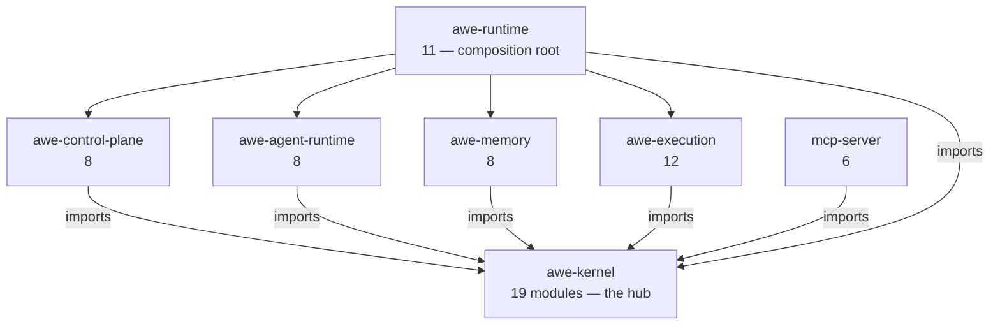
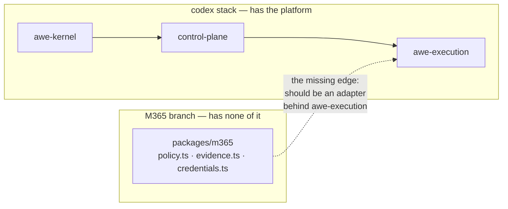

# AWE Component Graph

**Date:** 2026-08-01 · `codex/durable-execution-plane` @ `55c0ba5`

The package/data/control-flow diagrams live in `context/AWE_SYSTEM_MAP.md` — that is the file agents
read. **This document adds what a map cannot show: the actual import counts, and where the declared
boundaries are not enforced.**

---

## 1. Real dependency edges (from source imports, not `package.json`)

Measured by grepping `from '(../)+<pkg>/src'` across `packages/*/src`:

| Edge | Import sites |
|---|---|
| `* → awe-kernel` | **26** |
| `* → awe-control-plane` | 4 |
| `* → awe-runtime` | 1 |
| `* → awe-memory` | 2 |
| `* → awe-agent-runtime` | 2 |
| `* → awe-execution` | 1 |

**Acyclic.** Nothing imports `awe-runtime` except scripts, and `awe-kernel` imports nothing from a
sibling. That is a genuinely clean layering — worth protecting.

## 2. The boundary that is convention, not enforcement

**No package declares another as an npm dependency.** `packages/*/package.json` dependency blocks are
empty except `mcp-server` (`@modelcontextprotocol/sdk`, `@supabase/supabase-js`, `zod`). Every
cross-package edge above is a **relative filesystem path** (`from '../../awe-kernel/src/...'`).

Consequences:

- The workspace never needs a link step, and the runners work with zero build. That is why the whole
  suite runs in under a second.
- But npm cannot enforce the layering. Nothing stops `awe-kernel` importing `awe-execution` tomorrow
  except **Runner D's source-purity assertion** (*"core has no provider, network or ambient
  runtime"*) and code review.
- Publishing any `@exattime/*` package would break immediately — the relative paths do not survive
  packaging.

**Integration implication:** if the packages are ever to be consumed independently, the relative
imports must become declared workspace dependencies. That is a real migration, not a rename, and it
is not scheduled.

## 3. Where each capability was introduced

| Capability | Branch of origin | Packages added |
|---|---|---|
| Kernel + control plane + runtime shell | `feat/kernelized-mcp-context` (+20) | `awe-kernel`, `awe-control-plane`, `awe-runtime` |
| Live MCP data boundary | `codex/live-mcp-data-boundary` (+24) | — (tests + hardening) |
| Agent Runtime | `codex/agent-runtime` (+26) | `awe-agent-runtime` |
| Memory Layer | `codex/memory-layer` (+28) | `awe-memory` |
| Durable Execution Plane | `codex/durable-execution-plane` (+33) | `awe-execution` |
| M365 Integration Plane | `claude/microsoft-365-integration-plane-fcsm1e` (+1 **from `main`**) | `m365` — **and none of the above** |

## 4. The integration boundary that does not exist yet

`packages/m365` was built on `main`, so it has no access to `awe-kernel`'s gates, the control plane's
policy/journal, or the durable execution plane. Whatever policy, evidence, credential and idempotency
handling it implements is **parallel to** the platform's, not built on it.

Deciding whether to draw that edge is `AWE-INT-102`. It is architectural reconciliation, **not a
merge**.

## 5. Circular dependencies and duplicate domain models

- **Circular imports: none found.**
- **Duplicate domain models: one, pending.** `packages/m365/src/{policy,evidence,contracts}.ts`
  duplicates concepts owned by `awe-control-plane/src/policy.mjs`, `scripts/lib/artifact-store.mjs`,
  and `awe-execution/src/contracts.mjs`. Not yet a conflict — they live on branches that have never
  met — but it becomes one the moment both land.
- **No duplicate database tables.** All 23 tables are created exactly once across `0001`–`0016`. The
  only collision is the migration *filename slot* `0016` (C-101), not a table.
